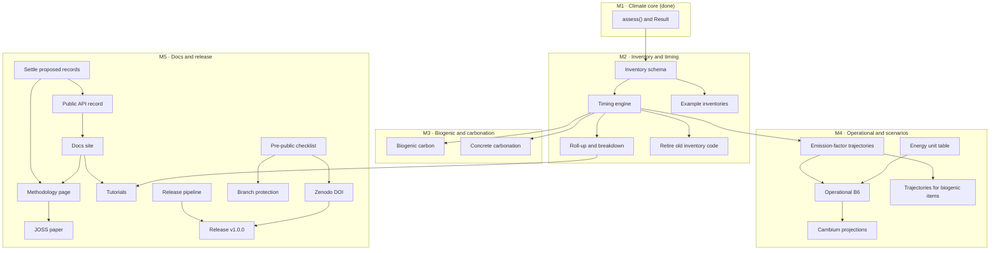

# Roadmap

How `dlca` gets from the research code to a tested, citable v1.0 package. This
file holds the plan: the milestones, what each one covers, and the order of
work. Progress lives on GitHub, in the
[milestones](https://github.com/jayarehart/DLCA/milestones) and their issues.
Where this file and GitHub disagree, GitHub wins. Fix this file by PR.

## How to use and update this file

- One milestone is one release. Each planned item below becomes one GitHub
  issue, and one issue is one PR (see `AGENTS.md`).
- Planned items have no issue numbers until their issues exist. When an issue
  is opened, add its number to the item here.
- Change this file by PR when the scope or order of work changes, or when a
  decision changes what a later item must do. Status (open, closed, merged) is
  not copied here.
- Jay approves creating milestones and issues. Items marked **needs Jay** need
  a decision or data from Jay before an agent can finish them.

## v1.0 scope

The core climate engine, building inventory and timing, biogenic carbon,
concrete carbonation, operational energy, and decarbonization scenarios for
replacement and end-of-life emissions. The public API stays backend-agnostic:
pure functions with JSON-serialisable inputs and outputs (record 0005).

## Milestones

| Milestone | Version | Scope | GitHub |
|---|---|---|---|
| M0 · Foundation | v0.1.0 | Licence, `src/` layout, tooling, CI, agent guide, decision records, spreadsheet reference tests | [milestone 1](https://github.com/jayarehart/DLCA/milestone/1) (closed) |
| M1 · Climate core | v0.2.0 | AR5 and AR6 parameter sets, atmospheric decay, forcing, GWI, temperature change, GTP, static GWP, carbon-cycle feedback, `assess()` and `Result` | [milestone 2](https://github.com/jayarehart/DLCA/milestone/2) (closed) |
| M2 · Inventory and timing | v0.3.0 | EN 15978 input schemas (building totals or a full inventory), dated B4/B5 events, end-of-life timing, roll-up from material to building, retire the old inventory code | [milestone 3](https://github.com/jayarehart/DLCA/milestone/3) |
| M3 · Biogenic and carbonation | v0.4.0 | Biogenic carbon (uptake, storage, release) and concrete CO₂ uptake | [milestone 4](https://github.com/jayarehart/DLCA/milestone/4) |
| M4 · Operational and scenarios | v0.5.0 | Time-varying emission factors for replacement and end-of-life emissions, operational energy (B6). Remove the fake DOE data | [milestone 5](https://github.com/jayarehart/DLCA/milestone/5) |
| M5 · Docs and release | v1.0.0 | Settle the proposed API records and the public API, docs site, tutorials, GitHub release, Zenodo DOI, JOSS paper, repository goes public, then branch protection | [milestone 6](https://github.com/jayarehart/DLCA/milestone/6) |

## Decisions from M0 and M1 that shape later work

These are settled. Later items must work within them or propose a new decision
record that supersedes one.

- **What the engine takes** (records 0008, 0010). `assess()` takes kg of each
  gas per year, not kg C, under the keys `co2`, `ch4`, `ch4_fossil` and `n2o`,
  index 0 = year 0. Fossil CH₄ goes under `ch4_fossil` and is oxidised to CO₂;
  `ch4` is non-fossil CH₄ with no carbon credit. Negative values are allowed,
  so uptake (biogenic, carbonation) can be passed as negative `co2`.
- **Biogenic carbon credit belongs in the inventory** (record 0010, decision
  C8; #33, #44). AR6 Table 7.15's non-fossil CH₄ value subtracts the CO₂ that
  the biogenic carbon took from the air (44.01/16.043 kg CO₂ per kg CH₄). DLCA
  does not do this in the engine. The inventory must supply that uptake as
  `co2`, and nothing may apply it twice.
- **Parameter sets** (records 0002, 0007, 0009). AR6 is the default and
  includes the carbon-cycle feedback; AR5 has none. Every result records the
  set's name and fingerprint, and mixing sets raises. A change to any value is
  a `science` change.
- **The engine is linear in its inputs.** Property tests check linearity,
  superposition and time shift with AR5 and AR6, fossil and non-fossil CH₄
  (`tests/property/`). So results for parts of a
  building (a module, a material) add up to the result for the whole.
- **Result format** (record 0008). `Result.to_dict()` is versioned JSON, now
  schema version 4. Any change to that format must bump the version.
- **Timing** (record 0003, partly superseded on #57). EN 15978 modules A1–A3,
  A4–A5, B1–B7 and C1–C4. The timing rule for each module is a `science`
  decision and needs its own record.
- **Inventory input** (decisions S1–S15 on #57, 2026-11-20). Two input schemas:
  `BuildingTotals` (whole-building kg per module) and `BuildingInventory`
  (Building → Assembly → Material, quantity × per-unit factors). One building
  uses one or the other, never a mix. Module D is out of scope and refused.
  There is no service life or replacement interval: B4 (replacement) and B5
  (refurbishment) are dated events the user enters, and a B4 amount is the
  whole replacement (new item's A1–A5 plus old item's C1–C4). B1–B3, B6 and B7
  are constant per year. These supersede record 0003 on module D and on service
  life; the schema decision record will say so.
- **Reference tests** (record 0001). Where DLCA disagrees with the Cooper et al.
  (2020) spreadsheet, the test is `xfail(strict=True)`. Expected values are
  never edited to match.
- **Horizon** (record 0012). Horizons below 1e-6 yr are refused.

## Order of work

M3 and M4 can run in parallel once the timing engine lands. The energy unit
table and the release pipeline depend only on M0 and can start at any time.

## Planned items

### M2 · Inventory and timing (v0.3.0)

1. **Inventory schemas** (#57; `science`, decided). Pydantic models
   `BuildingTotals` and `BuildingInventory` with EN 15978 modules A1–A3,
   A4–A5, B1–B7 and C1–C4, B4 and B5 as dated events, and kg of each gas under
   the `assess()` keys (`ch4` and `ch4_fossil` are separate). No module D, no
   service life, no biogenic field until M3. Exports a JSON Schema for each.
   Adds pydantic as a dependency.
2. **Timing engine** (#58; `science`). Turns either input schema into the yearly emissions
   `assess()` takes. Places B4 and B5 events in the years given, spreads the
   per-year modules over their years, and puts C emissions in the end-of-life
   year (which also sets the last allowed B4 year). The timing rule for each module needs a decision record. It replaces
   `EmissionsFluxEngine`, whose known bugs must not carry over: module fluxes
   overwrite each other instead of adding, and C lands in years 60–74 instead
   of one year (the strict xfail `test_building_lifecycle_flux_builder`).
   Blocked by item 1.
3. **Roll-up and breakdown** (#59; `science`). Sums material to assembly to building, and
   breaks results down by module, gas and material. Because the engine is
   linear, the parts must add up to the whole; a test checks this. If the
   breakdown goes into `Result`, the JSON schema version goes up. Blocked by
   item 2.
4. **Example inventories** (#60; `science`, **needs Jay**). Timber, steel and concrete
   assemblies as shared test data, with B4 and B5 as dated events. Only
   shareable data goes in the repo.
   Blocked by item 1.
5. **Retire the old inventory code** (#61). Remove `EmissionsFluxEngine`
   (`src/dlca/engine.py`) and the old inventory models in `src/dlca/models.py`
   (`AnalysisPeriod`, `MatEmissionsTiming`, `EmissionsInventory*`,
   `EmissionsFlux*`) once the new schema and timing engine cover them. This
   also removes the `AnalysisPeriod.years_vec` class attribute and the
   operational stub. The building and energy models stay until M4. Blocked by
   item 2.

### M3 · Biogenic and carbonation (v0.4.0)

1. **Biogenic carbon** (#73; `science`, decided). Regrowth model options
   (Cherubini Gaussian, instant, none), storage, and release at end of life,
   passed to the engine as `co2` (uptake negative). This is also where the
   biogenic-carbon credit for non-fossil CH₄ lives (record 0010, C8): decide
   how the inventory counts the carbon that a biogenic CH₄ source took from the
   air, and test that it is counted once.
2. **Concrete carbonation** (#74; `science`, decided; PR #77, record 0017).
   Lagerblad (2005): √t uptake in use and a crushed stockpile at end of life,
   as negative `co2` in two timeline parts of their own. The legacy model was
   not ported (it never ran and had known bugs) and `legacy/carbonation/` is
   deleted. Other models are #76.

### M4 · Operational and scenarios (v0.5.0)

1. **Emission-factor trajectories** (#81; `science`, decided; PR #87, record
   0018). Constant, linear to a target year, or a user-supplied series,
   applied to the fossil gases of B4 replacement and C emissions. Refused for
   now on buildings with biogenic items (item 5).
2. **Operational energy, B6** (#82; `science`, decided; PR #88, record 0019).
   Energy by fuel times an emission factor (eGRID2023 Rev 2 subregion and
   state factors, EPA 2025 Hub fuel factors, or the user's own) on a
   trajectory. Users supply their own energy use. Removed the fake DOE data
   (`DOE_energyuse_fake.csv`) and the building models that read it.
3. **Energy unit table** (#80; PR #83). A small internal table (kWh, MJ, GJ,
   MMBtu, kBtu, therm), with tests. Internally the package uses kg and years.
4. **NREL Cambium grid projections** (#85; `science`, decided; record 0021).
   A packaged Cambium 2024 extract (`aer_gen_*_c`, 8 scenarios, 18 GEA
   regions), joined to NLR's GEA history, as a B6 electricity factor series.
5. **Trajectories for biogenic items** (#86; `science`, **needs Jay**). Lift the #81 refusal
   so buildings with biogenic items can use a B4/C trajectory without
   scaling the biogenic release.

### M5 · Docs and release (v1.0.0)

1. **Settle the proposed records** (#95; `science`, **needs Jay**). Records
   0008 (`assess()` and `Result`), 0009 (parameter fingerprint guard) and 0010
   (carbon-cycle feedback) are still Proposed. An agent checks each record's
   claims against the code, and Jay accepts, amends or supersedes each one.
   The public API should not be frozen at v1.0 until this is done.
2. **Public API record** (#96; `science`, **needs Jay**). A decision record
   (0022) on which names are public, what semver covers (Python API, input and
   result JSON versions, packaged data and parameters) and the deprecation
   policy, then `__all__` to match and a test that guards it. Blocked by
   item 1.
3. **Docs site** (#97). mkdocs-material and mkdocstrings, with an API
   reference for the public names, a strict build in CI, and a GitHub Pages
   deploy that stays off until the repository is public. Blocked by item 2.
4. **Methodology page** (#98; **needs Jay**). One page on what the model
   computes, each rule linked to its decision record and its function. It
   mirrors the paper. Blocked by items 1 and 3.
5. **Tutorial notebooks** (#99). Material, assembly, building and scenario
   comparison, executed in CI, using only the shared example inventories.
   Blocked by item 3.
6. **Release pipeline** (#100). Version from the git tag (`hatch-vcs`), a
   check that the wheel holds the packaged data, and a GitHub release with the
   wheel and sdist on each `v*` tag. No PyPI in M5.
7. **Zenodo DOI** (#101; **needs Jay**). `.zenodo.json`, an updated
   `CITATION.cff`, and the Zenodo GitHub integration, which needs a public
   repository. Blocked by item 9.
8. **JOSS paper** (#102; **needs Jay**). `paper.md`, `paper.bib`, the
   statement of need, and a PDF build in CI. Blocked by item 4; submission
   waits for item 11 and a public repository.
9. **Pre-public checklist** (#103; **needs Jay**). Scan the history for
   secrets and data files, check issue and PR text, badges and links, then
   Jay makes the repository public.
10. **Branch protection on main** (#16; **needs Jay**). Require CI and Jay's
    review. Blocked by item 9.
11. **Release v1.0.0** (#104). CHANGELOG, tag, GitHub release and DOI, then
    mark M5 done here. Blocked by all of the above.

## Not scheduled

Put off during M1. Each needs an issue and a milestone before work starts.

- Parameter uncertainty ranges and Monte Carlo sampling (#26), including the
  carbon-cycle feedback's uncertainty rows (#33).
- The CO₂ sink of 0.7 ± 0.7 kg per kg that AR6 gives for biogenic CH₄, which
  neither parameter set models (#26).
- Caching `ClimateParameters.fingerprint()` if speed ever matters (#37).
- Publishing to PyPI. Left out of M5 by Jay's choice; releases are on GitHub.
- Other concrete carbonation models, such as Jungclaus et al. (2025) (#76).
