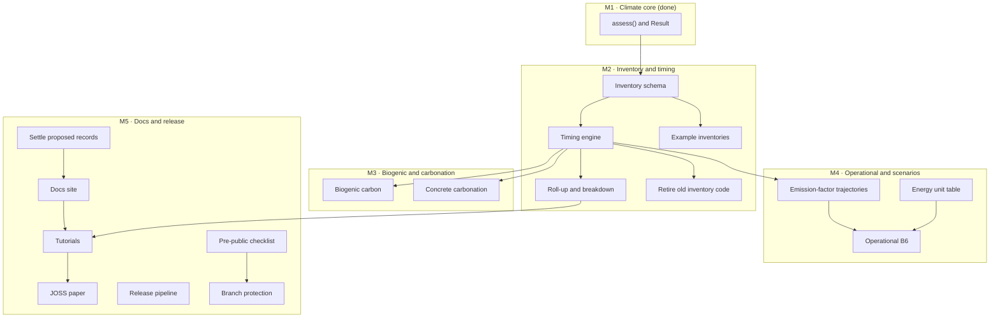

# Roadmap

How `dlca` gets from the research code to a tested, citable v1.0 package. This
file holds the plan: the milestones, what each one covers, and the order of
work. Progress lives on GitHub, in the
[milestones](https://github.com/jayarehart/DLCA/milestones) and their issues.
Where this file and GitHub disagree, GitHub wins. Fix this file by PR.

## How to use and update this file

- One milestone is one release. Each planned item below becomes one GitHub
  issue, and one issue is one PR (see `AGENTS.md`).
- Planned items have no issue numbers until their issues exist. When an issue
  is opened, add its number to the item here.
- Change this file by PR when the scope or order of work changes, or when a
  decision changes what a later item must do. Status (open, closed, merged) is
  not copied here.
- Jay approves creating milestones and issues. Items marked **needs Jay** need
  a decision or data from Jay before an agent can finish them.

## v1.0 scope

The core climate engine, building inventory and timing, biogenic carbon,
concrete carbonation, operational energy, and decarbonization scenarios for
replacement and end-of-life emissions. The public API stays backend-agnostic:
pure functions with JSON-serialisable inputs and outputs (record 0005).

## Milestones

| Milestone | Version | Scope | GitHub |
|---|---|---|---|
| M0 · Foundation | v0.1.0 | Licence, `src/` layout, tooling, CI, agent guide, decision records, spreadsheet reference tests | [milestone 1](https://github.com/jayarehart/DLCA/milestone/1) (closed) |
| M1 · Climate core | v0.2.0 | AR5 and AR6 parameter sets, atmospheric decay, forcing, GWI, temperature change, GTP, static GWP, carbon-cycle feedback, `assess()` and `Result` | [milestone 2](https://github.com/jayarehart/DLCA/milestone/2) (closed) |
| M2 · Inventory and timing | v0.3.0 | EN 15978 inventory schema, replacement schedule, end-of-life timing, roll-up from material to building, retire the old inventory code | not yet created |
| M3 · Biogenic and carbonation | v0.4.0 | Biogenic carbon (uptake, storage, release) and concrete CO₂ uptake | not yet created |
| M4 · Operational and scenarios | v0.5.0 | Time-varying emission factors for replacement and end-of-life emissions, operational energy (B6). Remove the fake DOE data | not yet created |
| M5 · Docs and release | v1.0.0 | Settle the proposed API records, docs site, tutorials, PyPI, Zenodo DOI, JOSS paper, repository goes public, then branch protection | not yet created |

## Decisions from M0 and M1 that shape later work

These are settled. Later items must work within them or propose a new decision
record that supersedes one.

- **What the engine takes** (records 0008, 0010). `assess()` takes kg of each
  gas per year, not kg C, under the keys `co2`, `ch4`, `ch4_fossil` and `n2o`,
  index 0 = year 0. Fossil CH₄ goes under `ch4_fossil` and is oxidised to CO₂;
  `ch4` is non-fossil CH₄ with no carbon credit. Negative values are allowed,
  so uptake (biogenic, carbonation) can be passed as negative `co2`.
- **Biogenic carbon credit belongs in the inventory** (record 0010, decision
  C8; #33, #44). AR6 Table 7.15's non-fossil CH₄ value subtracts the CO₂ that
  the biogenic carbon took from the air (44.01/16.043 kg CO₂ per kg CH₄). DLCA
  does not do this in the engine. The inventory must supply that uptake as
  `co2`, and nothing may apply it twice.
- **Parameter sets** (records 0002, 0007, 0009). AR6 is the default and
  includes the carbon-cycle feedback; AR5 has none. Every result records the
  set's name and fingerprint, and mixing sets raises. A change to any value is
  a `science` change.
- **The engine is linear in its inputs.** Property tests check linearity,
  superposition and time shift with AR5 and AR6, fossil and non-fossil CH₄
  (`tests/property/`). So results for parts of a
  building (a module, a material) add up to the result for the whole.
- **Result format** (record 0008). `Result.to_dict()` is versioned JSON, now
  schema version 4. Any change to that format must bump the version.
- **Timing** (record 0003). EN 15978 modules A1–A3, A4–A5, B1–B7 and C1–C4,
  with module D reported separately and not added to the A–C total. The timing
  rule for each module is a `science` decision and needs its own record.
- **Reference tests** (record 0001). Where DLCA disagrees with the Cooper et al.
  (2020) spreadsheet, the test is `xfail(strict=True)`. Expected values are
  never edited to match.
- **Horizon** (record 0012). Horizons below 1e-6 yr are refused.

## Order of work

M3 and M4 can run in parallel once the timing engine lands. The energy unit
table and the release pipeline depend only on M0 and can start at any time.

## Planned items

### M2 · Inventory and timing (v0.3.0)

1. **Inventory schema** (`science`, **needs Jay**). Pydantic models for
   Material, Assembly and Building, labelled with EN 15978 modules A1–A3,
   A4–A5, B1–B7 and C1–C4, plus module D kept separate (record 0003). Each item
   carries a service life and a replacement interval. Emissions are kg of each
   gas, and each CH₄ amount says whether it is fossil, so that it maps onto
   `ch4` or `ch4_fossil`. Leave room for biogenic carbon (M3) without
   modelling it yet. Exports a JSON Schema. Adds pydantic as a dependency.
2. **Timing engine** (`science`). Turns an inventory into the yearly emissions
   `assess()` takes. Places B4 replacements on the service-life schedule, puts
   C emissions in the end-of-life year, and keeps module D out of the A–C
   total. The timing rule for each module needs a decision record. It replaces
   `EmissionsFluxEngine`, whose known bugs must not carry over: module fluxes
   overwrite each other instead of adding, and C lands in years 60–74 instead
   of one year (the strict xfail `test_building_lifecycle_flux_builder`).
   Blocked by item 1.
3. **Roll-up and breakdown**. Sums material to assembly to building, and
   breaks results down by module, gas and material. Because the engine is
   linear, the parts must add up to the whole; a test checks this. If the
   breakdown goes into `Result`, the JSON schema version goes up. Blocked by
   item 2.
4. **Example inventories** (**needs Jay**). Timber, steel and concrete
   assemblies as shared test data. Only shareable data goes in the repo.
   Blocked by item 1.
5. **Retire the old inventory code**. Remove `EmissionsFluxEngine`
   (`src/dlca/engine.py`) and the old inventory models in `src/dlca/models.py`
   (`AnalysisPeriod`, `MatEmissionsTiming`, `EmissionsInventory*`,
   `EmissionsFlux*`) once the new schema and timing engine cover them. This
   also removes the `AnalysisPeriod.years_vec` class attribute and the
   operational stub. The building and energy models stay until M4. Blocked by
   item 2.

### M3 · Biogenic and carbonation (v0.4.0)

1. **Biogenic carbon** (`science`, **needs Jay**). Regrowth model options
   (Cherubini Gaussian, instant, none), storage, and release at end of life,
   passed to the engine as `co2` (uptake negative). This is also where the
   biogenic-carbon credit for non-fossil CH₄ lives (record 0010, C8): decide
   how the inventory counts the carbon that a biogenic CH₄ source took from the
   air, and test that it is counted once.
2. **Concrete carbonation** (`science`). Port the model in `legacy/` as CO₂
   uptake in the B and C modules (negative `co2`), tested against the legacy
   results.

### M4 · Operational and scenarios (v0.5.0)

1. **Emission-factor trajectories**. Constant, linear to a target year, or a
   user-supplied series, applied to B4 replacement and C emissions.
2. **Operational energy, B6** (`science`, **needs Jay**). Energy by fuel times
   an emission factor (the packaged eGRID 2020 subregion and state factors,
   plus fuels) on a trajectory. Users supply their own energy use. Removes the
   fake DOE data (`DOE_energyuse_fake.csv`) and the building models that read
   it. Blocked by items 1 and 3.
3. **Energy unit table**. A small internal table (kWh, GJ, MMBtu, kBtu), with
   tests. Internally the package uses kg and years.

### M5 · Docs and release (v1.0.0)

1. **Settle the proposed records** (**needs Jay**). Records 0008 (`assess()`
   and `Result`), 0009 (parameter fingerprint guard) and 0010 (carbon-cycle
   feedback) are still Proposed. The public API should not be frozen at v1.0
   until Jay accepts or replaces them.
2. **Docs site**. mkdocs-material and mkdocstrings on GitHub Pages, with a
   methodology page that mirrors the paper and draws on the decision records.
3. **Tutorial notebooks**. Material, assembly, building and scenario
   comparison, executed in CI.
4. **Release pipeline**. Version from the git tag (v0.2.0 was set by hand in
   `pyproject.toml`), CHANGELOG, PyPI trusted publishing, Zenodo DOI with
   `.zenodo.json`.
5. **JOSS paper** (**needs Jay**). `paper.md` and the statement of need.
6. **Pre-public checklist** (**needs Jay**). Check the history for anything
   private, check badges and links, then make the repository public.
7. **Branch protection on main** (**needs Jay**, issue #16). Require CI and
   Jay's review. Waits until the repository is public.

## Not scheduled

Put off during M1. Each needs an issue and a milestone before work starts.

- Parameter uncertainty ranges and Monte Carlo sampling (#26), including the
  carbon-cycle feedback's uncertainty rows (#33).
- The CO₂ sink of 0.7 ± 0.7 kg per kg that AR6 gives for biogenic CH₄, which
  neither parameter set models (#26).
- Caching `ClimateParameters.fingerprint()` if speed ever matters (#37).
