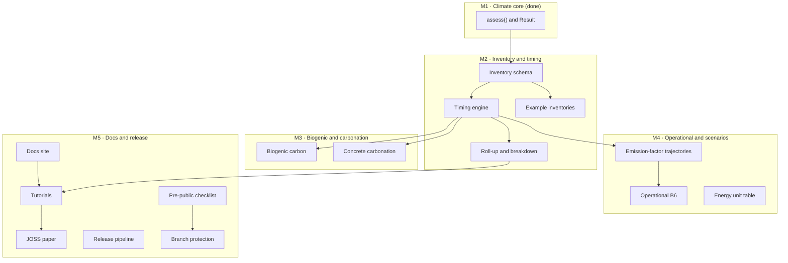

# Roadmap

How `dlca` gets from the research code to a tested, citable v1.0 package. This
file holds the plan: the milestones, what each one covers, and the order of
work. Progress lives on GitHub, in the
[milestones](https://github.com/jayarehart/DLCA/milestones) and their issues.
Where this file and GitHub disagree, GitHub wins. Fix this file by PR.

## How to use and update this file

- One milestone is one release. Each planned item below becomes one GitHub
  issue, and one issue is one PR (see `AGENTS.md`).
- Planned items have no issue numbers until their issues exist. When an issue
  is opened, add its number to the item here.
- Change this file by PR when the scope or order of work changes. Status
  (open, closed, merged) is not copied here.
- Jay approves creating milestones and issues. Items marked **needs Jay** need
  a decision or data from Jay before an agent can finish them.

## v1.0 scope

The core climate engine, building inventory and timing, biogenic carbon,
concrete carbonation, operational energy, and decarbonization scenarios for
replacement and end-of-life emissions. The public API stays backend-agnostic:
pure functions with JSON-serialisable inputs and outputs (decision record 0005).

## Milestones

| Milestone | Version | Scope | GitHub |
|---|---|---|---|
| M0 · Foundation | v0.1.0 | Licence, `src/` layout, tooling, CI, agent guide, decision records, spreadsheet reference tests | [milestone 1](https://github.com/jayarehart/DLCA/milestone/1) (closed) |
| M1 · Climate core | v0.2.0 | AR5 and AR6 parameter sets, atmospheric decay, forcing, GWI, temperature change, GTP, static GWP, `assess()` and `Result` | [milestone 2](https://github.com/jayarehart/DLCA/milestone/2) (closed) |
| M2 · Inventory and timing | v0.3.0 | EN 15978 inventory schema, replacement schedule, end-of-life timing, roll-up from material to building | not yet created |
| M3 · Biogenic and carbonation | v0.4.0 | Biogenic carbon (regrowth and storage options) and concrete CO₂ uptake | not yet created |
| M4 · Operational and scenarios | v0.5.0 | Time-varying emission factors for replacement and end-of-life emissions, operational energy (B6). Remove the fake DOE data | not yet created |
| M5 · Docs and release | v1.0.0 | Docs site, tutorials, PyPI, Zenodo DOI, JOSS paper, repository goes public, then branch protection | not yet created |

## Order of work

M3 and M4 can run in parallel once the timing engine lands. The energy unit
table and the release pipeline depend only on M0 and can start at any time.

## Planned items

### M2 · Inventory and timing (v0.3.0)

1. **Inventory schema** (`science`, **needs Jay**). Pydantic models for
   Material, Assembly and Building, labelled with EN 15978 modules A1–A3,
   A4–A5, B1–B7 and C1–C4, plus module D kept separate (decision record 0003).
   Each item carries a service life and a replacement interval. Exports a JSON
   Schema. Adds pydantic as a dependency.
2. **Timing engine** (`science`). Turns the modules into yearly emissions in
   the form `assess()` takes: kg per year under the keys `co2`, `ch4`,
   `ch4_fossil` and `n2o`, index 0 = year 0. Places B4 replacements on the
   service-life schedule, puts C emissions in the end-of-life year, and keeps
   module D out of the A–C total. The timing rule for each module needs a
   decision record. Blocked by item 1.
3. **Roll-up and breakdown**. Sums material to assembly to building, and
   breaks results down by module, gas and material. Blocked by item 2.
4. **Example inventories** (**needs Jay**). Timber, steel and concrete
   assemblies as shared test data. Blocked by item 1.

### M3 · Biogenic and carbonation (v0.4.0)

1. **Biogenic carbon** (`science`, **needs Jay**). Regrowth model options
   (Cherubini Gaussian, instant, none), storage, and release at end of life.
2. **Concrete carbonation** (`science`). Port the model in `legacy/` as a
   source of CO₂ uptake in the B and C modules, tested against the legacy
   results.

### M4 · Operational and scenarios (v0.5.0)

1. **Emission-factor trajectories**. Constant, linear to a target year, or a
   user-supplied series, applied to B4 replacement and C emissions.
2. **Operational energy, B6** (`science`, **needs Jay**). Energy by fuel times
   an emission factor (eGRID subregion, fuels) on a trajectory. Users supply
   their own energy use. Removes the fake DOE data.
3. **Energy unit table**. A small internal table (kWh, GJ, MMBtu, kBtu), with
   tests. Internally the package uses kg and years.

### M5 · Docs and release (v1.0.0)

1. **Docs site**. mkdocs-material and mkdocstrings on GitHub Pages, with a
   methodology page that mirrors the paper.
2. **Tutorial notebooks**. Material, assembly, building and scenario
   comparison, executed in CI.
3. **Release pipeline**. Version from the git tag, CHANGELOG, PyPI trusted
   publishing, Zenodo DOI with `.zenodo.json`.
4. **JOSS paper** (**needs Jay**). `paper.md` and the statement of need.
5. **Pre-public checklist** (**needs Jay**). Check the history for anything
   private, check badges and links, then make the repository public.
6. **Branch protection on main** (**needs Jay**, issue #16). Require CI and
   Jay's review. Waits until the repository is public.
